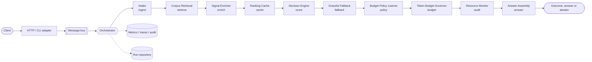

# Data flow

1. Agent initiates an action (LLM call or Tool use).
2. Decision Engine checks current resource usage against the active Policy.
3. If within limits, action proceeds; Resource Monitor logs the delta.
4. Resource Monitor sends usage data to the Budget Policy Learner.
5. Learner updates its internal state and potentially refines the Policy based on reward signals (e.g., task success vs. cost).
6. Updated Policy is pushed to the Decision Engine for the next step.

The `PipelineContext` is the only mutable object in a run. Stages read the request,
mutate candidates, and append decisions. Nothing else carries run state.
